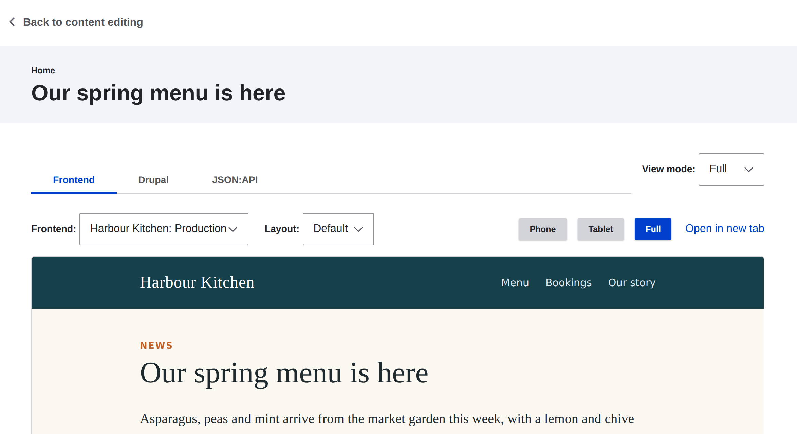

# Consumer Node Preview

[](https://git.drupalcode.org/project/consumer_node_preview/-/pipelines)
[](https://github.com/Decipher/consumer_node_preview/actions/workflows/test.yml?query=branch%3A1.0.x)
[](https://codecov.io/gh/Decipher/consumer_node_preview/branch/1.0.x)

Shows unsaved content in your decoupled frontends from Drupal's Preview button.
Each consumer lists the frontend URLs that render its previews, beside
Drupal's own preview and the JSON:API document.



For a full description of the module, visit the
[project page](https://www.drupal.org/project/consumer_node_preview).

Submit bug reports and feature suggestions, or track changes in the
[issue queue](https://www.drupal.org/project/issues/consumer_node_preview).

## Table of contents

- Requirements
- Installation
- Configuration
- Target URLs
- Registering targets over the API
- Troubleshooting
- Maintainers

## Requirements

- Drupal 10.3 or later, or Drupal 11
- [Consumers](https://www.drupal.org/project/consumers)
- [JSON:API Node Preview](https://www.drupal.org/project/jsonapi_node_preview)
- JSON:API and Node (Drupal core)

JSON:API Node Preview 1.0.0-beta5 and earlier serve stale or missing
paragraphs, and turn their resolver off on sites with JSON:API Resources.
Until a release includes them, apply the fixes from
https://www.drupal.org/i/3367724.

## Installation

1. Download and install via Composer. JSON:API Node Preview is in beta, so
   require it with the module:

   ```bash
   composer require drupal/jsonapi_node_preview:^1.0@beta drupal/consumer_node_preview
   ```

2. Enable the module:

   ```bash
   drush en consumer_node_preview
   ```

## Configuration

1. Edit a consumer at **Administration > Configuration > Web services >
   Consumers**. Add its **Preview targets**: a label and a URL for each
   frontend, such as local, staging and production. **Preview layouts** lists
   the layouts the frontend can render a preview in. The first is the default.
2. Allow each frontend's origin in the site's `services.yml`. The frontend
   fetches the preview with the editor's session, so it needs credentials:

   ```yaml
   cors.config:
     enabled: true
     allowedHeaders: ['*']
     allowedMethods: ['GET']
     allowedOrigins: ['http://localhost:3000']
     supportsCredentials: true
   ```

   Never use a wildcard origin with `supportsCredentials`.
3. Edit a node, change something, and press **Preview**.

The Frontend picker on the preview screen groups the targets by consumer.
Each group has the consumer's label, and the groups are in label order. In a
group, each target shows its own label, in the order the consumer lists them.
A group shows its label even when it is the only one, so the editor can see
which consumer the framed target belongs to. Consumers with the same label share
a group. A consumer labelled "Site" or "Inactive" shows as "Site (consumer)" or
"Inactive (consumer)" when that group is also in the picker.

A target that its frontend registers expires when the frontend stops
registering it. See "Registering targets over the API". A target that you add
by hand, on the consumer form or in settings.php, never expires.

When the preview screen opens, the editor's browser asks each frontend's
origin for a response, with a time limit of 3 seconds. A frontend that does
not answer shows "(not responding)" after its label in the Frontend picker.
You can still pick it, because a frontend that is asleep can wake up when you
open it. The check runs after the page loads, so it does not delay the
preview. A target that is a path on Drupal's own site is not checked. A
target in the Inactive group is not checked either, so the check never wakes a
frontend that is asleep.

Targets that differ per environment can live in settings.php. They come
first in the Frontend picker, in a group labelled **Site**:

```php
$settings['consumer_node_preview'] = [
  'targets' => [
    'frontend' => [
      'label' => 'Frontend',
      'url' => 'https://www.example.com/node/preview?vm=[view_mode]&layout=[layout]#[jsonapi_node_preview_path]',
      // Optional. The layouts this frontend can render a preview in.
      'layouts' => ['default', 'preview'],
    ],
  ],
  // Optional. Else the first target opens.
  'default' => 'settings:frontend',
  // Optional. The seconds before a registered target goes inactive. The
  // default is a day.
  'inactive_after' => 86400,
  // Optional. The seconds before cron deletes a registered target. The
  // default is 30 days.
  'delete_after' => 2592000,
];
```

A settings target can also be a path from the site root, such as
`/node/preview`. That suits a frontend that Drupal's own host serves.

## Target URLs

A target URL is a template that can use these tokens:

- `[jsonapi_node_preview]`: the absolute URL of the node's JSON:API preview
  document.
- `[jsonapi_node_preview_path]`: the same, as a path, for a frontend that
  reaches Drupal through a proxy on its own origin.
- `[uuid]`: the node's UUID.
- `[view_mode]`: the view mode being previewed.
- `[layout]`: the layout picked in the Layout select, or nothing.

A good target URL looks like this:

```text
https://www.example.com/node/preview?vm=[view_mode]#[jsonapi_node_preview]
```

- The document URL goes in the fragment, after `#`. Browsers do not send the
  fragment to the server, so the URL stays out of the frontend's server logs.
- `[view_mode]` goes in the path or the query. A new view mode then changes
  the frame's URL, and the frame reloads.

### Reading the document URL

The frontend's preview page gets the document URL from the fragment:

```js
const url = decodeURIComponent(location.hash.slice(1))
  // Some routers change "https://" to "https:/". Put the slash back.
  .replace(/^(https?):\/(?!\/)/, '$1://')
const response = await fetch(url, { credentials: 'include' })
```

The browser can encode characters in the fragment, so decode it first.
`credentials: 'include'` sends the editor's Drupal session cookie with the
request.

### Opening a target from a link

Query parameters on Drupal's preview URL pick what the Frontend tab shows:

- `?frontend=<key>` picks the target. The key is `settings:<name>` for a
  target in settings.php, or `<consumer id>:<delta>` for a consumer's target.
  `2:0` is the first target of consumer 2.
- `?layout=<name>` picks one of that target's layouts.

## Registering targets over the API

A frontend can read and replace its consumer's targets and layouts:

```text
GET /api/consumer-node-preview/targets?consumer=<uuid>
PUT /api/consumer-node-preview/targets?consumer=<uuid>
Content-Type: application/json

{
  "targets": [
    {"label": "Local", "url": "http://localhost:3000/node/preview?vm=[view_mode]#[jsonapi_node_preview]"}
  ],
  "layouts": ["default", "preview"]
}
```

`layouts` is optional. A PUT without it keeps the consumer's layouts. Instead
of `consumer`, the `X-Consumer-ID` header or a `consumerId` query parameter can
name the consumer by its client ID. A request that doesn't name a known
consumer gets a 404.

A frontend can also register only its own target, with a PATCH:

```text
PATCH /api/consumer-node-preview/targets?consumer=<uuid>
Content-Type: application/json

{
  "target": {"label": "Local", "url": "http://localhost:3000/node/preview?vm=[view_mode]#[jsonapi_node_preview]"},
  "layouts": ["default", "preview"]
}
```

The PATCH replaces the consumer's target with the same label, in its place.
If there is none, it adds the target at the end. The other targets do not
change. `layouts` is optional, as for a PUT. The answer is the same as for a
GET.

### Expiry

A PATCH records the time it registered the target. A frontend that keeps
running should send the same PATCH again from time to time, such as every few
hours. If a day goes by without one, the target moves to an **Inactive**
group at the bottom of the Frontend picker. Its label there names its
consumer. You can still pick it, and its key does not change. The next PATCH
moves it back to its consumer's group. After 30 days without one, cron
deletes the target.

Only a PATCH records the time. A target added by hand, on the consumer form
or in settings.php, has no time, so it never expires. A PUT records no time
either. A target that a PUT or the consumer form leaves unchanged, with the
same label and URL, keeps its time. A target with a new label or URL has no
time, so it is then a target added by hand. To change the two limits, see
`inactive_after` and `delete_after` in the settings.php example above.

### Access

Access needs the `register consumer node preview targets` permission, and
ownership of the consumer or the `administer consumer entities` permission.
`X-Consumer-ID` only selects a consumer. It never grants access. A PUT or
PATCH with the session cookie needs the `X-CSRF-Token` header from
`/session/token`. A PUT or PATCH from a browser on another origin also needs
that method in the CORS `allowedMethods`.

## Troubleshooting

### The Frontend tab shows an error instead of the draft

The editor's session cookie did not reach Drupal. Without it, the preview
document answers 404.

Drupal's session cookie is `SameSite=Lax`. Browsers send it only when the
frontend and Drupal share a site, such as `www.example.com` and
`cms.example.com`. Ports and subdomains can differ. A frontend on another
domain, such as `example.vercel.app`, does not get the cookie.

For a frontend on another domain:

- Give it a host name on the site's domain, such as `preview.example.com`.
- Or serve Drupal through a proxy on the frontend's origin, and use the
  `[jsonapi_node_preview_path]` token. The editor then signs in through that
  proxy, so the session cookie belongs to the frontend's host.

Also check that:

- the site's CORS settings allow the frontend's origin, with
  `supportsCredentials: true`;
- the preview page fetches with `credentials: 'include'`;
- the frontend lets Drupal show it in a frame. An `X-Frame-Options` header,
  or a `frame-ancestors` rule in its Content Security Policy, blocks the
  frame.

## Maintainers

- Stuart Clark - [deciphered](https://www.drupal.org/u/deciphered)
